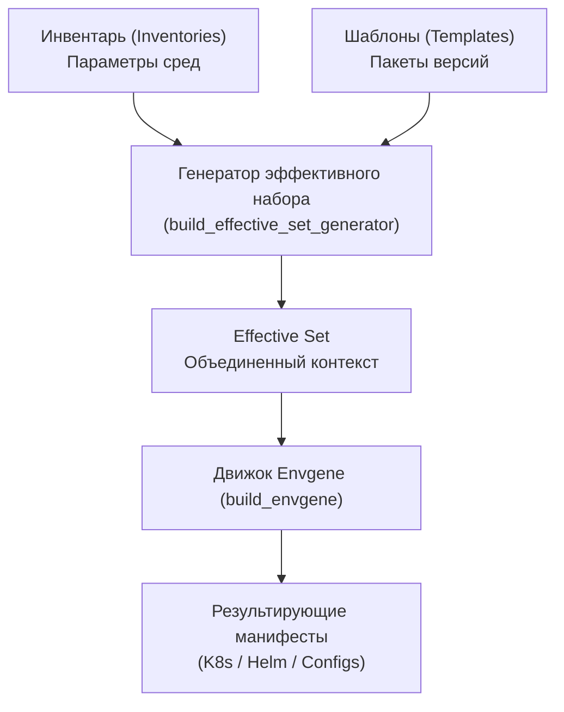

# Qubership Envgene Architecture Overview

Общий обзор архитектуры и компонентов инструмента **Envgene** (Environment Generator).

---

## 🎯 Назначение

Envgene предназначен для декларативной генерации и версионирования конфигураций облачных сред на основе шаблонов и инвентаря параметров. Он позволяет управлять сотнями похожих окружений (dev, stage, prod, tenant clusters) без дублирования кода.

---

## 🏗️ Ключевые компоненты

### 1. Инвентарь (`Inventory`)
- Структурированные YAML-файлы с описанием параметров окружений.
- Иерархическое наследование и переопределение значений.
- Управление секретами с шифрованием.

### 2. Шаблоны (`Templates`)
- Версионируемые пакеты конфигурационных файлов.
- Модули и переиспользуемые блоки.
- Поддержка хранения артефактов в репозиториях (Maven / OCI / Git).

### 3. Генератор эффективного набора (`build_effective_set_generator`)
- Модуль, рассчитывающий итоговые значения параметров с учетом наследования, приоритетов и переопределений для целевого окружения.

### 4. Движок генерации (`build_envgene`)
- Выполняет подстановку параметров, рендеринг шаблонов и генерацию целевых манифестов.

### 5. Тестовый контур (`cucumber_tests`)
- BDD-тесты на основе Gherkin/Cucumber.
- Проверяют корректность рендеринга манифестов при различных комбинациях инвентаря и шаблонов.
